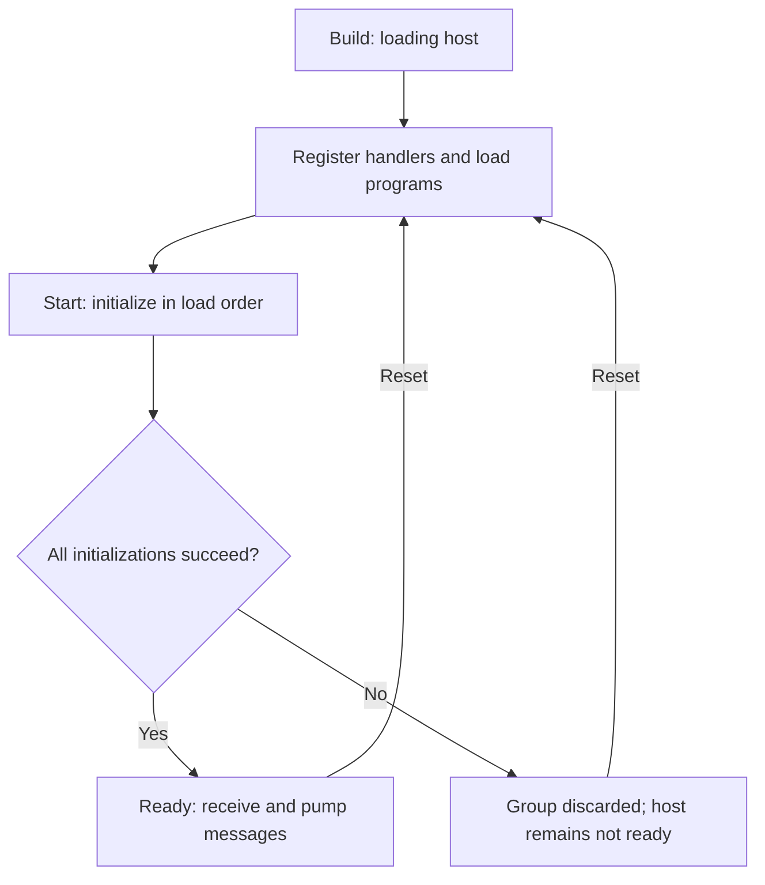
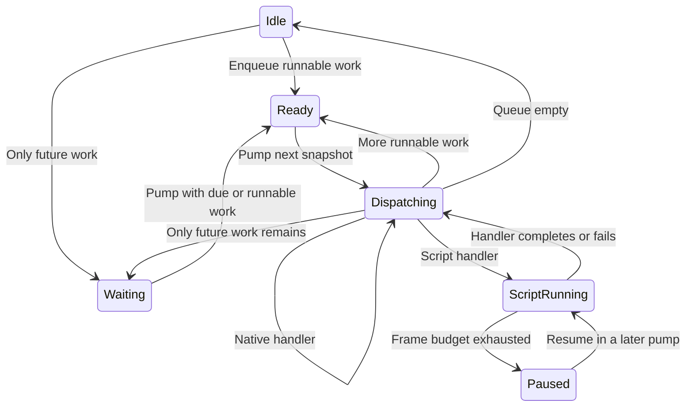

<!-- Copyright 2026 Stephan Schlöpke -->
<!-- SPDX-License-Identifier: Apache-2.0 -->

# Host runtime specification

> **Since: 0.1.0**

This document defines the portable runtime boundary shared by
Swift, Kotlin, Go, Rust, C++, C#, and Unity implementations. C# is the
reference implementation. Language-specific threading and reflection
must stay outside the portable core.

## Responsibilities

`GameEventScriptProgram` is the immutable parsed `.gesb` artifact. It contains
portable runtime segments and optional debug/source/build/opaque segments, but
no VM state, random generator, delegate, host binding, or queue. The normative
container is defined by [Binary format](BinaryFormat.md). A program may be loaded into multiple hosts at
the same time. All public program segments copy their input and expose read-only views. Its
resource metadata contains only portable integers: per-handler requirements in
message-handler binds and their maxima in the program header model.

`GameEventScriptHost` is one autonomous serial execution unit. It owns the local
message queue, exact- and name-subscription indexes, private random stream,
runtime limits, observer, optional outbound sink, linked program instances, and
at most one reusable `GesVirtualMachine`. A host may contain only native handlers and
does not create a VM until the first program is loaded. Host construction accepts
a seed, entropy bytes, or an immutable sequence configuration, never a live
mutable generator; building two hosts from the same configuration creates two
independent streams.

`GesProgramInstance` is one host-specific link of one program. `Load` is
additive and returns an instance. Linking resolves extension and external-type
references against that host. The host assigns a stable, non-reused registration
ID. The instance retains only its host and ID for lifecycle operations; it does
not retain a detach closure. `Detach` is idempotent and removes the instance from
future dispatch snapshots. Before registering anything, loading rejects a cyclic
synchronous call graph or requirements above `MaxRegisterValues` and
`MaxCallDepth`. It then pre-warms the reusable register storage from the program
maximum.

`GesSubscription` represents one native registration. `Unsubscribe`
uses the same host-owned registration-ID model, is idempotent, and affects future
snapshots only. Registration IDs are host-local lifecycle identities and are not
wire or program identities.

Portable native handlers implement `IGesNativeMessageHandler` and
receive the message plus the host's context through `Handle`. The Core stores the
handler object directly and contains no `Action` delegate adapter. C# callers may
use the `Action<GameEventScriptMessage, GesContext>` convenience
overloads in `CSharpBridge`; other ports provide their own language-idiomatic
adapters without changing the Core contract.

An extension function may throw `GesExtensionFaultException` to
deliberately report a defined failure, or throw any other exception
unanticipated by the runtime; [Diagnostics](Diagnostics.md) owns the resulting
stable codes and the shared "current handler only, host stays reusable, never
`nothing`" contract shared with native handlers and the external-type boundary.

`GesContext` is created once per host and passed to native handlers
and extensions. It exposes the host random stream, limits, `Emit`, and `Publish`.
Its random generator supports nested `Push()`, `Push(Int64)`, and `Pop()` scopes.
It does not own a queue, VM, or scheduler. A context or its random generator must
not be retained for asynchronous use after a native or extension callback.

`GesVirtualMachine` is the host's reusable virtual machine. It executes Programs
and contains only the currently resumable execution: active linked program, instruction
pointer, registers, frames, stages, and active message. Random state and its
scope stack belong to the host-owned generator so extensions observe the same
active scoped stream as bytecode. The host
reuses this machine serially for every script handler and fully resets it after
completion or failure. VM pooling across hosts is not part of this architecture.

All portable failures follow [Diagnostics](Diagnostics.md). Ordinary runtime handler failures
are reported to the observer, abort/reset only the failing handler, and leave the
remaining immutable dispatch snapshot runnable. A pump result that observed a
handler failure uses `RuntimeError` and carries its first diagnostic. Successful
VM stepping, resume, and dispatch do not allocate diagnostic objects.

Native callback atomicity means that the portable scheduler does not preempt a
callback; it does not imply a transaction over application state. Initialization
output staging and failure cleanup below cover host-managed registrations and
outputs, not state already changed by native callbacks. Application-state
ownership is defined in [Language](Language.md#state-ownership).

## Compatibility of message behavior

Within a compatible release line, the enqueue-time recipient snapshot, dispatch
priority and registration order, FIFO rules, initialization barriers, delayed
message tie-breaking, and specified failure/detach handling remain part of the
observable language contract. A compiler or runtime update must not independently
change them. This preserves the specified ordering guarantees, not wall-clock
execution speed or ordering between independent hosts.

For recompiled code, changed random results or opcode counts can affect subsequent
messages and frame/limit outcomes under the exceptions in
[Determinism](Semantics/Determinism.md#compatibility-and-recompilation). Delayed
execution additionally depends on clock observations and embedding pump calls.
A speed improvement alone is not a promise of identical real-time interleaving
with external inputs. Native callbacks remain subject to the embedding's contract.

## Loading and startup

`Build()` creates a host in its initial loading phase. `IsReady` is false, even
when `IsIdle` is true. Register native handlers and call `Load` for every initial
Program before `Start`. `Receive` returns false before a successful Start;
`ExecuteFrame` and `RunToCompletion` reject pumping a host that is not ready.

`Load` validates and links before committing registration. Validation, resource,
link, and initialization-queue capacity failures leave registrations, queued
messages, active execution and random state unchanged. An initialization snapshot
reserves one queue slot under `MaxQueuedMessages`; insufficient capacity
raises `link.initializationQueueFull`. A Program without initialization needs no
slot. Loading is available to embedding code and native message handlers.
Reentrant loading during active script/extension execution or the initial Start
is rejected; paused execution between frames does not prohibit host-side loading.
Scripts and extension contexts have no loading API.

The initial lifecycle is summarized below. The readiness barrier completes
initializations before ordinary message dispatch begins.



### Initial group

`Start()` runs only initialization snapshots, in Load order. Handlers inside one
instance retain their declaration order. All initial registrations are already
available when any initialization emits, so its enqueue-time snapshot can include
another member of the group. No ordinary queued message is dispatched by Start.

Every initialization uses the ordinary runtime safety limits. Exhaustion fails
startup; the initial group never becomes partially ready. `MaxProcessedMessagesPerRun`
paces ordinary pumps and does not bound Start: Start completes every
initialization snapshot of the group, however many there are, because a failed
Start is terminal while a paced pump resumes later. Successful Start marks
the host ready and returns `StartResult.Ready`, while emitted messages may remain
queued. StartResult also reports initialization opcode, completed-snapshot, emit,
and publish counters; these exclude subsequent ordinary dispatch. A runtime fault or exhausted safety limit returns `RuntimeError` or
`RuntimeLimitReached`, with a structured diagnostic. Failure removes the group's
registrations and discards all its queued outputs, reporting each discarded
message as defined in [Send IDs](#send-ids). The host remains not ready and
cannot be started again until a [reset](#host-reset). Repeating Start returns its
original result without executing code. Reentrant Start and pump calls are rejected.

### Later instances

After Start, Load queues initialization at the normal FIFO position and returns
an Instance with absent `StartResult`. No extra priority is assigned to init.
The current logical message completes before the new initialization starts.
A later initialization may pause across `ExecuteFrame` calls. Its instance cannot
execute ordinary handlers until all its initialization handlers succeed. A later
Program without initialization has an immediate Ready result.

Success stores Ready on the instance and releases its buffered outputs. Failure
stores RuntimeError or RuntimeLimitReached and its diagnostic, removes the
instance's registrations, discards its buffered outputs, and cancels every pending
recipient entry belonging to that instance. Other recipients of the same logical
message retain their order and still execute. Messages with no surviving recipient
are removed without dispatch or undeliverable redistribution. Each discarded
output and removed message is reported as defined in [Send IDs](#send-ids). This failure
cancellation is stronger than ordinary Detach, which retains captured recipients.
The host remains ready; the embedding decides whether to retry with a new Load.
A new instance never inherits the previous instance's captured deliveries.

The instance's immutable completed StartResult remains readable after removal.
A startup safety limit is represented by `runtime.initializationLimitReached`;
the regular runtime-limit observer also identifies the limit and bound. Runtime
faults retain their original diagnostic code and context.

### Initialization outputs

Init `Emit` captures recipients and reserves its FIFO position immediately.
Local delivery waits until that instance succeeds. Queue limits include staged messages and queued initialization
snapshots. Overflow of staged outputs exhausts the initialization. External
Receive calls between paused init frames enter the ordinary queue independently
and are not discarded as that init's output. Observer emit notifications describe
attempts; their existence is not proof of committed delivery.

Init `Publish` also defers the external sink call: until the entire initial group
succeeds, or until the individual later init succeeds. Its immediate result has
`OutboundDeferred` when a sink exists, with OutboundAttempted/OutboundAccepted
false. AnyAccepted includes deferred acceptance. The observer receives the final
publish result on release; failed initializations never call the sink. Successful
local acceptance during init is provisional. Sink rejection/failure at release
retains ordinary publish semantics and does not undo successful initialization.
Direct external effects performed by arbitrary native callbacks are not rolled
back. Host readiness promises successful init, not completion of its emitted
message chains.

### Host reset

> **Since: Unreleased**

`Reset()` (Swift `reset()`) discards all queued, delayed and active work and
returns the host to the loading state. It keeps the loaded Programs, their
instances, native handlers and subscriptions, the reusable VM and the random
generator, which is neither reseeded nor rewound. It clears the runnable and
startup queues, delayed entries and [named timers](#named-timers), buffered
initialization outputs, a paused handler, the idle phase, the host's start result
and every instance's `StartResult`. The discarded entries are not reported
individually; the observer receives one `HostReset` instead. The initialization
of each attached instance is queued again in load order under new send IDs, which
keep counting, so a following `Start` runs it as the initial group and the
[Initial group](#initial-group) rules apply again. Until then `IsReady` is false
and the loading rules apply.

A reset is allowed on a loading, ready or failed host and between the frames of a
paused handler. A failed start has already detached its initial group, so a reset
after it yields a loading host without those Programs; the embedding loads them
again before the next `Start`. A reset is rejected while the host starts or pumps,
including from a native handler or another host callback, and from an observer or
publish-sink callback of a host operation outside pumping, such as `Detach` or a
captured context's `Emit` or `Publish`; the rejection changes nothing.

## Random Ownership, Boundaries, and Limits

`MaxRandomScopeDepth` is the exact number of simultaneously active regular
random scopes permitted in one host. Zero permits no nested scope. On first use,
the generator allocates that many parent-state slots plus one reserved fault-gate slot;
the gate does not reduce the configured usable depth. Runtime boundary markers
are separate metadata and do not count as random scopes.

The host marks the random scope depth when every native or script handler starts.
An extension call adds a nested marker. A script marker remains active while its
VM execution is paused between frames, and may therefore be released on a
different thread from the one that created it. Markers and scope state are
ordinary host-owned heap state; they never use thread-local, async-local, or
native call-stack storage.

The first push beyond `MaxRandomScopeDepth` copies the current valid stream into
the reserved gate slot, latches a `MaxRandomScopeDepth` runtime-limit fault, and
uses the current state only as disposable work until the active boundary returns.
Further pushes increment only a suppressed-depth counter and matching pops
decrement it; neither operation may reach the valid parent stack. Random draws
after the fault cannot alter the saved stream. `Emit` and `Publish` attempted
while the gate is active are observed as rejected, and Publish does not invoke
the outbound sink.

At boundary release the generator restores the gate state, unwinds every regular
scope above the marker, and clears the gate. Bytecode observes a rejected push
immediately and stops the current handler. An extension or native handler is an
atomic trusted callback and cannot be preempted portably; the VM or host stops
the handler as soon as that callback returns. No exception is part of this
contract. The observer receives one runtime-limit event and the pump returns
`RuntimeLimitReached`; the host remains reusable.

A pop may not cross the innermost runtime marker. Crossing it is a runtime error.
A callback that returns with otherwise balanced execution but leaves scopes open
is also a runtime error, after the marker first restores the parent stream. If a
different runtime limit already aborted a script body before its generated pops,
marker cleanup is expected recovery and adds no second imbalance diagnostic.

## External Type Boundary

External types use two deliberately separate inputs. Compilation receives an
`IGesExternalTypeCatalog` containing only declarative type, field,
constructor, parameter, and signature data. It does not contain executable
bindings. The resulting program stores only portable external-constructor import
bindings; it never stores the catalog or its definitions.

Host linking receives an `IGesExternalTypeRegistry` that resolves a
constructor import to an `IGesExternalTypeConstructor`. A resolved
constructor must report exactly the definition requested by the import. Runtime
values cross the portable boundary as `IGesExternalValue`, exposing
their declarative definition and field values without exposing a platform host
object.

A constructor or a field accessor may likewise throw
`GesExtensionFaultException` or an unanticipated exception; see
[Diagnostics](Diagnostics.md) for the resulting codes and contract.

The C# bridge may implement both inputs with one convenience object. Its
reflection metadata, attributes, CLR instances, field delegates, conversion,
and constructor invocation remain entirely inside `CSharpBridge`. Portable JSON
conformance uses a manual catalog, constructor registry, and value
implementation and therefore does not depend on C# reflection.

## Handles

> **Since: Unreleased**

A [handle](Language.md#handles) refers to an object outside the host. Like external types, handles use two separate
inputs: compilation receives the declarative [handle catalog](PublicApi.md#handle-api), and the host receives one
resolver per handle type that reads state. GES never owns, stores or changes the objects; it reads them.

**Program and link.** A Program records every handle type it names, with the [link hash](Schemas.md#canonical-form) of
the declaration the compiler used, which covers its state schema, and whether the Program reads state of that type: a
member other than `id`, `version` and `root`, or a cast to the state schema or, **Since: Unreleased**, to one of
its projections. Load compares each recorded link hash with
the host's catalog, if one is configured, and fails with
`link.mismatchedHandleType` on a difference. A type whose state the Program reads needs a resolver, otherwise Load
fails with `link.missingHandleResolver`, located at the first instruction that reads the type's state as
[link call sites](Diagnostics.md#link-call-sites) describe. Comparing, `is`, Map keys, timer names and passing a handle on
need no resolver. A read whose handle type is not statically known, such as `.@Root` or a state cast of an untyped
value, is not recorded; at run time it resolves through the type's resolver when the host registered one and otherwise
reads the object as missing, so it gives `nothing` without a fault.

**Resolution.** Reading state resolves the whole object lazily, the first time a handler reads it. The resolver
receives the handle, with its version if it carries one, and answers synchronously with exactly one of:

- the state as a Record of the state schema, optionally with the object's version;
- the state as `.gesd` document text, whose [schema header](Documents.md#schema-header) must name the state schema,
  optionally with the version;
- *missing*: the object does not exist, so every state read gives `nothing` and `h as :State` gives `nothing`.

The host checks the answer against the state schema as [document checking](Schemas.md#document-checking) does, with
defaults applied. A state that does not fit, a document that does not read or names another schema, and an answer
without a result fail with `runtime.invalidHandleState`. A resolver that throws or reports a failure fails with
`runtime.handleResolveFailed`. Both stop the handler like an extension fault. A resolver failure is classified like an
[extension failure](PublicApi.md#diagnostics-and-failure-transport): a fatal runtime failure (C#
`GesFatalRuntimeException`, Swift `GesFatalRuntimeError`), such as an `ExtensionFaultException` with its own code,
propagates unchanged, and every other one becomes `runtime.handleResolveFailed`; the same holds for `ResolveRef`. A composite is resolved by its own type's resolver alone; when the
handle carries no root version, the resolver may pass the root's version it delivered.

**Versions.** For a `:ContentHash` type GES computes the [content hash](Schemas.md#content-hash) of the resolved
state; a resolver need not pass one. For every other versioned type the resolver passes the version it delivered;
when it passes none for a state, the version the handle carries applies, because the resolver answered for it, and a
handle that carries none fails with `runtime.invalidHandleState`, because no receiver could cache the state. A
*missing* answer needs no version. A passed version that differs from the computed hash, or from the version the
handle carries, fails with `runtime.handleVersionMismatch`. A resolver of an unversioned type passes none; passing one
fails with `runtime.invalidHandleState`. A handle read without a version
picks up the resolved version for `as :State` and later reads in the same handler, but `h.version` keeps
reporting the version the value itself carries.

**Projections.** *Since: Unreleased.* A handle that a parameter or field of type `@Name(:P)` bound carries the
[projection](Schemas.md#projections) `P`; reading its state passes `P` to the resolver (C# `call.Projection`, Swift
`call.projection`, absent for the full view). The resolver answers with the state of the whole object, which the host
converts to `P`, or with a Record or document of `P` itself; the host checks the answer against the schema it names and
then against `P`, so a resolver that knows the projection may deliver less. For a `:ContentHash` type the version is the
content hash of the projected Record; a revision or owner's hash is the object's. A passed version is compared with the
version of what the resolver delivered: the full state's hash for a full state, the projection's for a projected one.
Narrowing to a pinned projection computes that projection's version in the same way when a parameter binds, and
reads the object as missing when the resolver answers *missing* or *not visible*. Narrowing to an unpinned view drops
the version and resolves nothing. A handle with a projection that reaches a parameter or field of a wider view, which
only an untyped value can, binds `nothing`. A plain Record converted with `as :P` is projected with the schema of the
host's registered handle type that has `P`, without a resolver call; its Program links only with that resolver
(`link.missingHandleResolver`).

**Parties and visibility.** *Since: Unreleased.* Each read names the party it is for (C# `call.Party`, Swift
`call.party`): 0 for the host itself, otherwise the host-local number that a [network](Network.md) assigns to a
connection. A resolver may answer *not visible* (`SetNotVisible`, Swift `setNotVisible()`) when that party may not see
the object at all. The script cannot tell it from *missing*: every state read gives `nothing`, so the answer does not
reveal that the object exists. The host reports it to the observer with the diagnostic code `runtime.handleNotVisible`,
which no handler sees and which does not stop the handler. A not-visible answer is cached like a missing one.

**Batches.** *Since: Unreleased.* The first state read of a handle that is an element of a List the handler's message
delivered, at any depth of its arguments, resolves that List's other elements of the same type and projection that are
not cached yet, together: the host calls the resolver's batch entry once (C# `ResolveMany`, Swift `resolveMany`) with
all of them, the read handle first and the rest in List order, and caches every answer. Each element is answered with
one of the answers above and checked alone, so one invalid answer fails the handler as a single read does. The default
batch entry resolves each handle on its own, in that order, so a resolver need not implement it. Handles that the
handler builds or takes from other values resolve one by one.

**Cache.** Each handler invocation owns one cache keyed by handle type, identity, carried version and projection. Every state
read of the same object in that invocation, including across pauses, uses the first answer, so a handler sees one
consistent state per object. A full state answer also serves later reads of the same object through any projection,
which the host derives from it. The cache ends with the invocation; nothing is shared between handlers or hosts. Cached
states are immutable values, so entries, and the values a handler took from them, may share storage.
Resolvers are called only from script execution on the host's serial path, never from loading or the pump itself.
Pausing resolvers are not part of this version; a later version may let resolution pause the handler like a frame.

**Refs.** A handle read from a document may carry a ref instead of a version. `ResolveRef` (Swift `resolveRef`)
asks the type's resolver to turn it into a version and returns the handle with that version; a handle without a ref
returns unchanged. A resolver that answers Nothing knows no such ref, and `ResolveRef` returns no handle (C# null,
Swift nil). A composite's ref is its root's and resolves through the composite type's resolver. A resolver of a type
without refs need not implement `ResolveRef`: the default reports an API error, which the host reports as
`runtime.handleResolveFailed`. A ref never reaches the VM: `Receive`, `Emit`, `Publish`, extension results and external field
values reject a value that contains one with `wire.unresolvedRef`, before anything is enqueued.

**Wire.** A schema-encoded handle carries its identity and, for `@Name~`, its version; the state never travels.
Network routes `owns` declare which side holds the objects of a type ([Network](Network.md)); resolving over the
network is not part of this version.

## Message Semantics

- Message arguments are ordered `GesMessageArgument` name/value
  pairs. Their order is part of `SignatureId`; neither Core construction nor
  conformance decoding derives it from a map's iteration order.
- Named argument labels must be unique after portable normalization. Repeated
  `_` labels remain valid because they represent distinct positional arguments.
- C# tuple construction is a `CSharpBridge` convenience. Its dictionary adapter
  requires a known `GesMessageSignature` and binds values in that
  signature's declared order.
- `Receive(message)` captures current subscription snapshots and queues the
  message locally. It never invokes the outbound sink.
- **Since: 0.5.0:** Only the host uses the system endpoints `initialization` and
  `undeliverable`. No Message can be constructed with those names and no Program can
  create one, as [Program validation](Bytecode.md) rejects them outside handler entries. An observer
  still sees the host's initialization message, and `Receive` rejects it. Signatures
  and handlers keep the names to subscribe.
- `Emit(message)` does the same from a running handler.
- `Publish(message)` first attempts the same local enqueue and then calls the
  host's single synchronous `IGesPublishSink`, if configured.
- `GesPublishResult` reports `LocalAccepted`, `OutboundAttempted`,
  `OutboundAccepted`, `OutboundDeferred`, and derived `AnyAccepted`. Sink rejection or exception
  never rolls back or corrupts local delivery. The observer sees the result.
- Queue limits count logical messages, not handler invocations.
- A send needs a queue slot for an instant message with local recipients and
  for every delayed entry. When it finds `MaxQueuedMessages` reached
  outside initialization, an Emit or Publish statement and a native Emit or
  Publish drop the local message, report the limit to the observer and continue
  the handler. A result-bearing or delayed send instead stops its handler with
  that limit before the send is observed.
- Each queued message owns immutable exact/name subscription snapshots and a
  cursor. Every matching handler finishes in priority/registration order before
  the next logical message starts.
- A detach, unsubscribe, subscribe, or load during dispatch does not modify
  already captured snapshots. It applies when a later message is enqueued.
- `on initialization` is a special per-instance handler, never normal external
  input. The initial Start barrier and subsequent FIFO initialization follow
  [Loading and startup](#loading-and-startup).

## Portable State Machine

> **Since: 0.2.0 — Waiting and delayed-work transitions**

The following pump states apply after successful Start. Initial loading and the
terminal startup-failure state are defined in [Loading and startup](#loading-and-startup).
Here `Ready` means queued work, distinct from the public `IsReady` startup flag.



The diagram is an overview; the transition rules include the following actions
and results. `RuntimeError` and `RuntimeLimitReached` are pump results, not
additional startup/readiness states.

| State / event | Action and next state |
| --- | --- |
| Idle; Receive, Emit, Publish, or Load with late initialization | Enqueue the captured snapshot. Runnable work leads to Ready; only future work leads to Waiting. |
| Ready; pump | Dequeue one logical message and enter Dispatching. |
| Dispatching; next native handler | Reset the per-handler safety budget and invoke atomically; remain Dispatching. |
| Dispatching; next script handler | Reset the per-handler safety budget; bind linked Program, entry and message to the host VM state; enter ScriptRunning. |
| Dispatching; no remaining handler | Complete the logical message. Continue in Ready when runnable work remains, Waiting when only timers remain, or Idle when the queue is empty. |
| Waiting; caller pumps | At or after NextMessageDelay, promote due messages behind runnable FIFO work and enter Ready. Remain Waiting if no work is runnable. Newly enqueued runnable work can be pumped before a future deadline. |
| ScriptRunning; frame budget remains | Execute opcodes synchronously; remain ScriptRunning or return to Dispatching. |
| ScriptRunning; frame budget exhausted | Enter Paused and retain the VM state. Resume that handler in a later pump. |
| ScriptRunning; handler completes | Fully reset VM state and return to Dispatching. |
| ScriptRunning; handler fails | Report the diagnostic, fully reset VM state and continue Dispatching; the pump result is RuntimeError. |
| ScriptRunning; handler safety limit reached | Reset VM state and stop the pump with RuntimeLimitReached. |


`ExecuteFrame(opcodeBudget)` is a caller-thread scheduler slice. Its opcode
budget is independent from safety limits and may pause only script bytecode;
native handlers remain atomic. `RunToCompletion()` pumps synchronously until the
host becomes idle, only future work remains, or a runtime limit stops the run. Core code starts no thread
and performs no synchronization. A host is serial but not thread-affine: only
one caller may access it at a time, while later frames may run on another thread
when the embedding environment supplies the required happens-before handoff.

The processed-message limit counts completed logical messages of ordinary pumps, after all of
their captured handlers have finished. After completing the configured number,
the pump reports `RuntimeLimitReached` and one corresponding observer event only
if another logical message remains queued. That next message stays queued and
is not started until a later pump call. If completing the last message drains
the queue exactly at the limit, the pump returns `Completed` without a
processed-message-limit observation, unless an independent error or limit
determines the result. These rules apply to both `ExecuteFrame` and
`RunToCompletion`, to native and script handlers, and to messages enqueued by
handlers during the pump.

### Literal parsing limits

Each `parse` and `parse strict` invocation has fixed portable bounds, applied only while executing
`ParseLiteral` or the public literal parsing API: at most 1,048,576 input Unicode scalars (`MaxLiteralInputScalars`),
64 nested List/Map/Dice/Vector/Point containers (`MaxLiteralDepth`), and 65,536
total List items, Map entries, Dice rolls, and explicitly supplied Vector/Point
components across the whole input (`MaxLiteralItems`). A Dice, Vector, or Point
literal consumes one container level, including an empty form; its syntax does
not imply an additional List. Omitted spatial components do not consume items.
Duplicate Map keys
still count as entries. Scalar roots do not consume an item or nesting slot.
Exactly each bound is allowed; the next scalar, nested container, or item
exceeds it. Input length is checked before recognition. Nesting and item bounds
are checked incrementally before creating the next container or reading the
next item; trailing syntax errors do not undo a limit already encountered.

One invocation also materializes at most `MaxRangeItems` Range items into Lists
in total, as in `:List(:Range(...))` forms; each materialization adds its full
Range length before the List is created. The total uses the Host's configured
`MaxRangeItems` and replaces the per-cast Range check inside `parse`: a single
Range longer than the limit already exceeds the total, so it exhausts the
handler like any other literal bound instead of producing an empty List.

Exceeding a bound exhausts the current handler with the existing runtime-limit
mechanism and the corresponding stable limit name and numeric bound. It does
not return original Text as a recognition fallback or emit a partial value.
Previously completed effects remain observable and subsequent queued messages
can run normally. The counters are local to one parse invocation; programs
without `parse` maintain no parsing state or counters. The public literal
parsing API has no handler to exhaust and instead fails with a literal limit
error, as owned by [Text semantics](Semantics/Text.md#recognition-outside-a-program).
[GES documents](Documents.md#limits) apply the same bounds per document.

### Iterator and Generated-Collection Limits

`MaxLoopIterations` counts successful iterator advances across all loops and
iterator-backed selectors in one handler. A present `nothing` item consumes one
iteration, just like any other value. Exhaustion and non-iterable sources consume
no successful-advance iteration. Compound intersection/difference additionally
charge this same counter before visiting each left candidate and before each
right search slot (including already-used slots). Map compound operations charge
each left candidate, each key-list validation item and each key search comparison. Failed searches therefore
cannot perform unlimited work inside one opcode. Exactly the configured number of advances is allowed; attempting
another successful advance stops the handler before its loop body or selector
expression executes. Nested and sequential loops share this counter. Frame
pauses retain it, and starting the next handler resets it.

`MaxGeneratedCollectionItems` bounds each collection incrementally materialized
by generated lists and iterator-backed selectors. The limit applies to retained
items, rather than the number of source items visited or a cumulative total
across separate collections:

- Compound iterator search masks and retained map results are individually
  bounded before growth. Cartesian pair Lists and entry Maps count their own
  retained components when materialized; direct register output creates no such
  collection and does not charge its size. Native Cartesian checks its outer
  product size using overflow-safe arithmetic before allocation.
- List projections, filters, and generated lists count every appended result,
  including `nothing`.
- Map projections count distinct accepted keys. Replacing an existing key's value
  does not grow the map; skipped empty or `nothing` keys do not count.
- Distinct-by projections count retained distinct keys, so discarded duplicates
  do not count again.
- Order-by projections count every buffered source item.
- Group-by projections limit both the number of groups in the result map and
  the number of items in each group's list, independently.

Exactly the configured collection size is allowed. Before an insertion would
exceed it, the runtime rejects that insertion without growing the collection and
stops the handler without returning a partial projection result. Previously
completed effects remain observable. This is an incremental materialization
limit, not a byte-allocation budget or a bound on existing input collections.

Operations that visit the items of a Range inside one opcode charge the same
`MaxLoopIterations` counter for each visited Range item, before visiting it:
`:contains any` and `:contains all` for each candidate of a Range, `HasAny` and
`HasAll` for each item of a binary64 Range, and `starts with` and `ends with`
for each compared pair when both operands are Ranges. Against an iterator,
`:contains any` and `:contains all` visit every Range candidate before the
search, because the iterator is read once. Integer Ranges need no visits where
their bounds decide the result: `HasAny` is true unless the Range is empty or
just `0`, `HasAll` is true unless the Range contains `0` (an empty Range has
all), and `starts with` or `ends with` between two integer Ranges compares the
first or last terms and, beyond one item, the steps. Shuffling a Range
materializes it, so a Range longer than `MaxRangeItems` reports that limit and
shuffles to an empty List, as the List cast does; choosing items at random from
a Range draws positions among the items not chosen yet and does not materialize
it.

For either limit, a nonpositive value disables that limit. An exceeded limit
produces one structured runtime-limit observation for the failing handler and
stops the pump with `RuntimeLimitReached`. Normal handler cleanup restores random
boundaries and clears VM state. Remaining handlers and queued messages stay
available for a later pump call.

### Value nesting

`MaxValueDepth` (default 64) bounds how deeply a handler nests the values it
constructs. A List, Map, Record or Message is one level deeper than its deepest
item, field or argument; every other value, including Dice, Bytes, Ranges,
Vectors, Points and external values, has depth 0, so a List of numbers has
depth 1 and an empty List also has depth 1. Exactly the configured depth is
allowed. Constructing a deeper value stops the handler with this runtime limit
before its next instruction, without returning the value; previously completed
effects remain. Values a handler receives as arguments, and values native code
builds through the API, are not checked until the handler nests them further.
A nonpositive value disables the limit.

The bound exists because converting, comparing, hashing and releasing a value
walks its nesting recursively in both ports. Without it, a handler that wraps
its accumulator once per step, or a message chain that wraps its argument once
per message, could exhaust the native stack, which neither port can catch. With
the default, every value a script builds converts and compares within the stack
of a 512 KB thread, and also stays within the nesting bounds of `parse` and of
the JSON codec. Each container records its depth when it is built, so the check
costs no walk of its items.

### Memory

Runtime limits bound the work, the nesting and the collection sizes of one
handler; they are not a memory budget. Concatenating Text, Lists, Dice or Bytes
and converting values to Text produce values whose size can double with each
instruction, so a few dozen instructions can request more memory than a
process has. C# reports a failed allocation as a handler error; Swift
terminates the process. A host that runs untrusted Programs bounds their memory
outside the runtime, for example by running them in a separate process with an
operating-system memory limit. A portable per-value size limit is deferred in
`BACKLOG.md`.

## C# Automatic Runner

Both native bridge runners are optional. They take ownership without implicitly
starting a loading host. Register handlers, load Programs, and call the runner's
synchronous Start; successful Start schedules remaining ordinary work. A runner
wrapping an already ready host schedules its pending work immediately. Both
runners serialize callbacks on a shared background dispatcher and expose readiness,
the last execution result and synchronized instance startup results.

`CSharpBridge.GesBridgeHostRunner` serializes access
to one host with a C# lock and schedules at most one pump job for that host on a
shared dispatcher. Concurrent `Receive`, `Load`, subscribe, detach, and
unsubscribe calls go through the runner: loading and subscribing return a runner-owned registration whose
lifecycle operations take the same lock, never the host's own handles. Creating a runner immediately schedules
one pump when its host is ready and already has pending work, including queued
messages, late initialization, or a paused script handler. No later `Receive` or `Load` is
required to start that work. An idle host waits for later accepted work.

The initial scheduling uses the same serialization gate and outstanding-job
guard as subsequent runner operations. The caller stops accessing the host
directly when transferring ownership; pending callbacks may start before
runner creation returns. Disposing the runner suppresses scheduled pumps that
have not started, while preserving the host's pending work.

Swift, Kotlin, Go, Rust, C++, and Unity provide
their own actor, executor, event-loop, or main-thread policy around the same
synchronous core contract.

## Hot-Path Rules

- Script registrations store `GesProgramInstance + EntryAddress`; no
  per-invocation delegate closure, runner object, or invocation interface exists.
- The queue is a preallocated growing ring of logical message envelopes.
- Dispatch selection walks captured arrays without constructing handler lists.
- Handler registrations prepare their dispatch signature once and reuse it for
  VM entry, observer callbacks, and diagnostics.
- Execution and publish results are value types.
- Program loading prewarms VM register capacity. Later register growth is
  geometric and bounded by `MaxRegisterValues`.
- Synchronous script call graphs are acyclic. A root handler has call-stack depth
  zero; every nested call adds one entry.
- After warmup, queue dispatch, handler selection, frame-result creation, and VM
  resume must not allocate. Message creation, emitted value payloads, extension
  behavior, and Conformance Markdown/YAML decoding are measured separately.
- Random boundary and scope storage is initialized on first use and retained by
  the host. Push, Pop, marker creation, overpush gating, and frame resume allocate
  nothing after that warmup.

## Conformance Porting Contract

Every implementation runs the Conformance Markdown cases through this sequence:

```text
source -> GameEventScriptProgram -> optional .gesb Write/Read -> Host.Load -> Host.Start
YAML step input -> GameEventScriptMessage -> Host.Receive
Host.ExecuteFrame or Host.RunToCompletion -> observed local/outbound messages
```

The same Markdown cases define ordering, tags, initialization, multiple programs,
frame pause/resume, runtime limits, and Emit/Publish/Receive behavior for every
language in the monorepo. Message `args` are always encoded as an ordered YAML
sequence of mappings with `name` and `value` entries, including nested message
values and expected local/outbound messages.

## Send IDs

> **Since: 0.5.0**

Every message the Host queues or processes carries a host-local send ID, a
positive Int64. A Host starts at 1 and assigns the next ID, in order of
occurrence, to each message queued by `Receive` or Emit, each processed Publish,
each delayed send, each arming of a repeating [named timer](#named-timers) and each
queued initialization message. An Emit or `Receive`
that queues nothing, for example without recipients or on a full queue, gets no
ID. Neither does a send rejected before it is processed: by an active
random-scope fault, an invalid or unrepresentable delay, a negative clock reading,
or a queue or named-timer limit that stops a result-bearing or delayed send. Every Publish the
Host processes owns an ID, even without local recipients and independent of the
sink outcome.
This is independent of the Boolean script result of a send: an Emit without
recipients returns true but has no ID. Send IDs therefore depend only on these
sends and are deterministic for identical inputs.

The ID belongs to the send, not to the immutable Message: it is never part of a
Program, a Message value, its JSON form or the outbound sink call, and IDs of
different Hosts are unrelated. Observer callbacks report the ID of the send they
describe: the Emit or Publish itself, its scheduling, and every dispatch of it,
including `undeliverable` fallback dispatch. Send ID 0 reports a send without an
ID. Without an observer, send IDs are unobservable and change no behavior.

A message with an ID that is removed before it is dispatched reports
`MessageDiscarded` with that ID exactly once. On initial-group failure these are
every pending initialization in load order, then every queued message in queue
order, then every delayed entry in deadline order, then every deferred
initialization Publish without a local queue entry in send-ID order. On
later-instance failure they are the failed instance's staged outputs and every
message it left without recipients: queued messages in queue order, then
delayed entries in deadline order, then its deferred Publishes without a local
queue entry in send-ID order. A deferred initialization Publish is never
released by a failed initialization, so its ID can appear only in this
callback; one with a local queue entry is reported once, with that entry. Dispatched and due
messages report no discard; their ordinary callbacks follow.

## Delayed dispatch

> **Since: 0.2.0**

Each Host borrows a monotonic clock reporting nonnegative whole microseconds.
The default clock measures actual elapsed time; an embedding can supply a clock
for deterministic simulation or testing. Clock reads never pump messages.

A positive finite time quantity is converted to microseconds, rounded upward.
Integer seconds are converted with checked integer arithmetic. Binary64 seconds
are multiplied by 1,000,000 using binary64 arithmetic and rounded upward; the
result must be smaller than 2^63. A negative input is invalid even if rounding
would produce zero. The absolute deadline is clock time at acceptance plus the
delay; overflow rejects the send. This is a minimum scheduling delay, not a
real-time execution guarantee.

Delayed entries capture the same recipient snapshot as instant enqueue. Newly
registered recipients do not receive older entries. Ordinary detach retains its
captured-delivery behavior. When deadlines become due, entries are appended to
the runnable FIFO in deadline order; equal deadlines retain enqueue order.
Promotion occurs between complete logical messages, never in the middle of an
active or paused handler. Future entries do not block runnable messages.

> **Since: 0.5.0** — delayed emits without recipients

A delayed emit whose snapshot, including the `undeliverable` fallback, is empty
at acceptance behaves exactly like the instant emit without recipients: it is
not scheduled, is observed as not queued, and its script result is unchanged. A
delayed publish is scheduled without local recipients, because its outbound sink
invocation remains due.

Publish delays both local delivery and the outbound sink invocation. A later sink
rejection or failure cannot change the Boolean already returned to script.
The existing sink diagnostic behavior remains applicable. Emit observations occur
at acceptance; delayed publish observations occur when the publication is released.

> **Since: 0.5.0** — scheduling observation

When an observer is configured, each accepted delayed send reports
`MessageScheduled` once with its send ID, immediately after it enters the delayed
queue and before the `MessageEmitted` of a delayed emit. Its deadline is the
absolute entry deadline in whole microseconds on the Host clock that
`NextMessageDelay` uses, neither a relative delay nor wall-clock time; the
publish flag distinguishes `publish … after` from `emit … after`. A zero delay is
an instant send (see `Language.md`), so it enters no delayed queue and reports
no `MessageScheduled`.

A delayed entry removed before it becomes due reports `MessageDiscarded` as
defined in [Send IDs](#send-ids). An entry that becomes due reports no
scheduling callback; its ordinary publish and dispatch callbacks follow with the
same send ID.

Init computes deadlines when the expression executes but cannot release its
outputs before its initial group or later-instance initialization succeeds.
Already due entries become eligible after that barrier. Initial-group failure
clears all outputs; later-instance failure clears its staged outputs and removes
captured deliveries to the failed instance without canceling independent outbound
publication or other recipients. Accepted sends outlive ordinary sender detach.
Delayed entries count towards the existing logical-message queue limit; promotion
does not reserve a second slot.

`RunToCompletion` and `ExecuteFrame` never wait or advance the clock. `Waiting`
means only future work remains, `Completed` means no work remains, and `Paused`
retains its frame-budget meaning. Errors and limits retain precedence.
`PendingMessageCount` includes delayed entries but excludes the active message;
`IsIdle` is false while delayed entries remain. `NextMessageDelay` reports remaining
whole microseconds, clamped to zero, or no value when there is no delayed entry.
Bridges and command-line adapters own timers and serialize all Host access.

## Named timers

> **Since: Unreleased**

A named send (`emit|publish after|every duration named key`,
[Language](Language.md#named-timers-and-heartbeats)) registers a named timer under
the sending Program instance and the key's text, or the key itself when it is a
[handle](#handles). Each instance has one namespace
for emit and publish; instances never see each other's names. A timer has one
current firing at a time, which is an ordinary delayed entry with its own send ID
and follows [Delayed dispatch](#delayed-dispatch) unless stated here. Only script
handlers send named and cancel; a send without an active instance, during an
active random-scope fault, with a negative clock reading or with an overflowing
deadline yields false and changes nothing.

**Replacement.** A named send whose name is registered removes the old timer's
waiting firing, delayed or promoted but not yet dispatched, and reports it with
`MessageDiscarded`; a firing whose handlers already run only loses its name and is
not re-armed. The new entry gets a new send ID, so it orders after existing entries
with an equal deadline. A one-shot emit without recipients at acceptance is not
scheduled, exactly like an unnamed delayed emit, and leaves the name free after
removing the old timer.

**One-shot timers.** An `after` timer is registered until its firing starts
dispatch, or until a due firing finds no local recipient and is dropped without a
`MessageDiscarded` report, like an unnamed delayed send. A
zero delay is allowed and schedules a firing that is due at once. Recipients are
captured at acceptance as for an unnamed delayed send.

**Repeating timers.** An `every` timer needs a period greater than zero; otherwise
the send yields false and changes nothing. Each firing captures its recipients,
including the `undeliverable` fallback, when it becomes due, not at the send, and
an emit firing reports `MessageEmitted` then. When all handlers of a firing's
logical message complete, the timer re-arms one period after the clock reading at
that completion, under a new send ID. While the firing is promoted, dispatched or
paused across frames, the timer stays registered with that firing's deadline. A
firing without a local recipient reports `MessageDiscarded` for an emit, still
releases a publish to the sink, and re-arms one period after its promotion. Missed
periods are never caught up, and a re-arming deadline that would overflow ends the
timer.

**Cancel.** `cancel key` selects the sending instance's timer of that name,
`cancel named` all its named timers, and `cancel all` additionally its unnamed
delayed entries that are not yet due. Selected waiting firings and entries are
removed, a firing whose handlers already run only loses its name, and the
expression yields true if anything was selected. Removals are reported with
`MessageDiscarded` before anything changes: promoted firings in send-ID order,
then delayed entries in deadline order. A one-shot timer whose handler runs is no
longer registered, so cancelling it from that handler yields false; a repeating
timer cancelled from its own handler yields true and does not re-arm.

**Lifecycle.** Detaching the sending instance ends its repeating timers: a
waiting delayed firing is discarded and reported, while a promoted firing keeps its
captured delivery. One-shot firings outlive the detach like other accepted sends,
but their names are released. Named sends of an initialization are staged as its
outputs; a failed initialization abandons its timers with its other outputs, and a
[reset](#host-reset) clears all timers without individual reports.

**Limits.** Every waiting firing counts towards `MaxQueuedMessages`; a replacement
reuses the slot of the waiting firing it removes. `MaxNamedTimers` (default 0,
unlimited) bounds the registered names of all instances of a host; a replacement
does not count again. A named send that would exceed either limit stops its
handler with that limit before the send is observed, like a delayed send on a full
queue.

**Observation.** `PendingTimers` (Swift `pendingTimers`) is a snapshot of all
registered timers, ordered by deadline and then by send ID, with name (a Text or
handle value), deadline of
the current firing in whole microseconds on the Host clock, period in whole
microseconds (0 for `after`), message name, sending instance and publish flag.
Reading it never pumps. Every arming of a timer reports `MessageScheduled` with
its name and period: the first by its send and each re-arming of a repeating timer.
Unnamed delayed sends report no name and period 0.

## Idle duration observation

> **Since: 0.3.0**

`IdleDurationMicroseconds` (Swift `idleDurationMicroseconds`) is an optional
nonnegative Int64 count of whole microseconds in the current ready, work-free
phase, measured with the Host's monotonic clock. It is absent before successful
Start and during pumping, active or paused handler execution, queued ordinary
messages or initialization, and delayed emits or publications. A deadline passing
alone does not finish work: the delayed entry must still be pumped.

The phase begins when successful Start or a pump returns with no active or
pending work. Accepted queued work ends it immediately; a later work-free
completion starts a new phase. Repeated observations, repeated Start, empty
pumps, subscriptions, loads without initialization and rejected inputs do not
restart an existing phase. A failed initial Start never establishes one. A
runtime error on a ready host does not itself prohibit a new idle phase if the
pump has actually left no active or pending work.

Reading the property never pumps, sleeps or schedules a message. External work
unknown to this Host does not affect the result. Embeddings choose their own
idle timeout and recovery message, such as a bot's `Idle()` event. The existing
`IsIdle` queue-emptiness observation remains unchanged and does not imply readiness.
All raw Host access still requires a single serialized caller. Native automatic
runners expose the duration under their gate and return no value after disposal
or close; they do not introduce an idle timer or automatic recovery messages.
