<!-- Copyright 2026 Stephan Schlöpke -->
<!-- SPDX-License-Identifier: Apache-2.0 -->

# GES network

> **Since: Unreleased**

This document owns GES network sessions. A `network` declaration in a
[schema source](Schemas.md) names which wire roots a client and a server exchange, and
in which delivery class. A session carries the encoded records of those roots between
the two sides over a transport: a TCP stream, WebSocket messages, UDP datagrams or the
in-process transport. The [network guide](../docs/guide/Network.md) introduces it step by step.

The session core is a synchronous state machine without threads, sockets, clocks or
allocation of its own resources at run time: bytes and the current time go in, bytes
and events come out. Transports are plug-ins around it. Equal inputs at equal times give
equal bytes and events in every port.

Not part of this version: bulk transfers and encryption.

## Principles

- A payload is the encoding of one record or message of a route's root, produced and
  read by the [schema writer and reader](Schemas.md#writer-and-reader). The session
  decodes no payload; it only converts the states of a [topic](#topics) between full
  records and [deltas](Schemas.md#deltas).
- Both sides hold the same network declaration bound with the same parameter values.
  The handshake compares hashes and closes the session on any difference.
- Data from the peer is untrusted. Every limit is known before a packet is read; a
  violation closes the session with a [code](#codes), never with a crash.
- Time is a monotonic Int64 count of microseconds, the unit of the
  [host clock](HostRuntime.md). The core never reads a clock.

## Declaration

A network declares the routes of one client–server pair:

```gess
wire schema :World as { tick: :Number integer between 0 and 65535 }
wire schema :World_Cards as { count: :Number integer between 0 and 255 }
wire messages :GameCommands as (Move, Fire)
wire schema :GameArena as { width: :Number integer between 0 and 4096 }

network :Game as {
  client sends :GameCommands reliable
  server sends :GameArena bulk
  server publishes :World latest
  server publishes :World_Cards latest at most every 200ms
}
```

The [schema grammar](Schemas.md#grammar) reads it:

```text
network = "network" ":" TypeName "as" "{" route { route } "}"
route   = ( "client" | "server" ) ( "sends" | "publishes" ) ":" TypeName
          ( "reliable" | "latest" | "bulk" ) [ "at" "most" "every" value ]
```

Routes are separated by commas or line breaks; repeated and trailing separators are
allowed. Each route stays on one line.

- **Side.** `client` routes go from the client to the server, `server` routes the other
  way.
- **`sends`** names a schema, a message or a message set with a `wire`
  [role](Schemas.md#roles). Its class is `reliable` or `bulk`.
- **`publishes`** names a schema with a `wire` role, a topic. Its class is `latest` or
  `reliable`.
- **`at most every`** stands only on `publishes` and states the shortest interval
  between two updates of the topic. Its value is a time quantity, written as a literal
  or a constant, greater than zero and at most `3600s`. It is rounded up to whole
  microseconds. The session itself does not enforce it; generated code exposes it as a
  [constant](Schemas.md#network-constants).
- A side names a root at most once per verb.
- A network holds 1 to 64 routes. The position of a route, counting from 0, is its
  route index; its channel on the wire is the index plus 1.

A network shares the namespace of schemas, messages, message sets and tag sets. It is no
type: a field or another route cannot name it. Code generation alone accepts it as a root and
writes its [constants and typed functions](Schemas.md#network-constants). A root may be abstract
nowhere in a network.

| Code | Condition |
| --- | --- |
| `schema.unknownName` | a route names no declared schema, message or message set |
| `schema.invalidRoute` | a route names a declaration of the wrong kind or without a `wire` role, an abstract schema, a class its verb does not take, a rate on `sends`, or a rate that is no time, not positive or above `3600s` |
| `schema.duplicateRoute` | a side names the same root twice with the same verb |
| `schema.tooLarge` | a network has more than 64 routes |

### Binding

Binding a network binds every route root with the same
[parameter values](Schemas.md#binding); the parameters of all roots must be given. A
bound network holds, per route, the bound root and its largest encoding, and the network
hash.

### Network hash

The network hash is FNV-1a 64, as for the [schema hash](Schemas.md#schema-hash), over
this canonical form: UTF-8 lines, each ending with one line feed, tokens separated by
one space.

```text
gesn1
network <TypeName>
route <client|server> <sends|publishes> <RootName> <class> <rate> <binding hash>
```

One `route` line follows per route in route order. `<class>` is `reliable`, `latest` or
`bulk`; `<rate>` is the interval in microseconds as a decimal integer, `0` without a
rate; `<binding hash>` is the root's [binding hash](Schemas.md#binding-hash) as 16
lowercase hexadecimal digits. Classes, rates, order, names and parameter values thus all
change the network hash.

## Sessions

A session connects one client and one server. Each side runs one connection, the state
machine of this document. A server runs one connection per client.

```mermaid
---
title: Connection states
accTitle: Connection states
accDescr: A client sends hello and waits for welcome; a server waits for hello, asks the host and sends welcome; both then exchange data until closed.
---
stateDiagram-v2
    [*] --> Hello: client created
    [*] --> AwaitHello: server created
    Hello --> Connected: welcome received
    AwaitHello --> AwaitAccept: valid hello
    AwaitAccept --> Connected: host accepts
    AwaitAccept --> Closed: host refuses
    Connected --> Closed: close, error, timeout
    Hello --> Closed: close, error, timeout
    AwaitHello --> Closed: close, error, timeout
```



1. The client sends `hello` with its network hash, the binding hash of every route, its
   limits, the compressions it accepts and the host's token.
2. The server checks the protocol and the hashes. On a difference it closes the session
   with `network.protocolMismatch` or `network.schemaMismatch`. Otherwise it reports the
   event `connecting` with the token, and the host accepts or refuses the client.
3. On acceptance the server sends `welcome` and reports `connected`; the client reports
   `connected` when it receives `welcome`. Refusal closes with `network.refused` and the
   host's detail.
4. Both sides then exchange `data` packets until one side sends `close`, the transport
   ends, an error closes the session or the peer stays silent for the timeout.

A client sends nothing but `hello` and `close` before `welcome`; a server sends nothing but
`welcome` and `close` before acceptance. Either receiving anything else is
`network.malformed`. On a datagram transport the handshake repeats lost packets and the
server validates the client's address first; the
[datagram handshake](#datagram-handshake) adds those rules.

### Delivery classes

| Class | Delivery |
| --- | --- |
| `reliable` | every message, complete, in the order sent across all reliable routes of the direction |
| `latest` | the newest message per route; a message not yet started is replaced by a newer one |
| `bulk` | every message, complete, in the order sent across all bulk routes of the direction, after all other traffic; each message is a [transfer](#transfers) |

Transmission order within a packet is: reliable, then latest, then bulk. A reliable or
bulk message is sent completely before the next one of its class starts; messages of
different classes interleave in fragments. On a stream or message transport a latest
message, once started, is completed; a newer message of the same route then waits in its
place and is itself replaceable. On a datagram transport a newer message starts once the
current one is sent, and the receiver drops an older incomplete one
([latest messages on datagrams](#latest-messages-on-datagrams)).

### Sending

A side sends a payload on its `sends` routes and publishes one on its `publishes` routes,
the [topics](#topics). Both return a status and never throw; the checks apply in table
order:

| Status | Meaning |
| --- | --- |
| `invalidRoute` | the route index is out of range, or the route is not sent by this side with this verb |
| `notConnected` | the connection is not `Connected` |
| `notSubscribed` | a published topic of the server is not subscribed |
| `messageTooLarge` | the payload is longer than the route root's largest encoding; on a bulk route also longer than the transfer limit of either side |
| `queueFull` | the reliable queue would exceed its byte limit; on a bulk route, 8192 transfers are queued or the queued bulk bytes plus the payload would exceed the transfer limit of either side |
| `queued` | the message is queued |

A latest message never makes the queue full; it replaces the waiting one.

### Topics

A topic is a `publishes` route. Its messages are states: each one is a full record of the
topic's schema, and the receiver gets the full record. On the wire a state travels as a
full record or as a [delta](Schemas.md#deltas) against an earlier state the receiver has
confirmed, whichever is shorter.

**Subscriptions.** The server decides which client receives which of its topics. A server
connection starts with none of them subscribed; the host subscribes and unsubscribes a
topic per connection, and publishing on a topic that is not subscribed reports
`notSubscribed`. Both are usage errors on a client connection and for a route that is no
topic the server publishes, and do nothing when the state does not change. Subscribing
sends nothing by itself; the host publishes the current state when it wants the client to
start with it. Unsubscribing drops the waiting latest state of the topic and the
sender's ring; a latest state already started is completed and reliable states already
queued are sent. The topics a client publishes are always subscribed.

**Numbering.** Every state has a number modulo 65536. A latest state's number is its
[message id](#frames), taken when its first fragment is sent; a latest state replaced
before it started gets no number. Reliable states are numbered from 0 per topic in the
order they are published. The receiver takes the same numbers: the message id of a latest
state and its own count of the reliable states of the topic.

**Rings.** Each side holds a ring of states with their numbers per topic and direction.
When a state enters
it, the oldest states leave while the ring holds more than 32 states or more than the
baseline limit of full record bytes, but the newest state always stays. The baseline
limit is the smaller of the limits both sides announce in the handshake.

**Sending a state.** Its base is the newest state of the sender's ring that is
confirmed. On a stream or message transport a state is confirmed when the packet
carrying its last fragment is acknowledged, and an acknowledgement confirms every packet
up to the sequence it names. On a datagram transport a reliable state is confirmed when
every byte of its message is acknowledged, and a latest state when a
[confirmation frame](#confirmation-frames) of the receiver names it. The
sender writes a delta against the base when there is one, the
[delta encoding](Schemas.md#deltas-between-records) succeeds, and the delta is shorter
than the full record; otherwise the full record. Then the state enters the ring.

**Receiving a state.** The receiver takes the base from its ring, decodes the delta
against it and reports the full record; a full record is reported as received. The state
then enters the receiver's ring. The receiver's ring always still holds the base: it
received the base and, after it, only states that also entered the sender's ring since,
so the states from the base on fit the same limits. On a datagram transport the receiver
of a latest topic skips states that were lost or overtaken; it then holds fewer states
after the base, which fit the limits all the more.

### Transfers

A message on a bulk route is a transfer: data of up to the transfer limit, sent with its
size and hash, compressed when that is shorter, and cancellable without closing the
session.

**Sending.** A transfer gets its id when it is queued: the next number of the bulk
numbering, which the host reads from the connection right after `send`. The sender
computes the SHA-256 hash of the data and, when both sides accept Deflate and the data
is not empty, compresses it with the [reference encoder](#deflate). The compressed form
is sent when it is shorter than the data, otherwise the data itself. The message is:

| Field | Encoding |
| --- | --- |
| compression | 1 byte: `0` none, `1` Deflate |
| size | varint of up to 64 bits, the length of the data |
| hash | 32 bytes, SHA-256 of the data |
| data | the data, or its raw Deflate stream ([RFC 1951](https://www.rfc-editor.org/rfc/rfc1951)) |

The size varint follows the [varint rules](#values) with up to ten bytes; a value above
64 bits is not canonical.

**Receiving.** The receiver checks a complete transfer in this order and cancels it with
the code, without reporting it, when a check fails:

| Check | Code |
| --- | --- |
| the message is empty or its size varint cannot be read | `network.transferCorrupt` |
| the size exceeds the receiver's transfer limit or the route root's largest encoding | `network.transferTooLarge` |
| the compression is unknown, or Deflate while the receiver does not accept it | `network.transferCorrupt` |
| fewer than 32 bytes follow the size | `network.transferCorrupt` |
| uncompressed data whose length differs from the size, or compressed data at least as long as the size | `network.transferCorrupt` |
| the Deflate stream is invalid or does not yield exactly the size | `network.transferCorrupt` |
| the hash of the data differs | `network.transferCorrupt` |

A transfer that passes is reported as `message` with the data and the transfer's id. A
message frame of a bulk route whose total exceeds the receiver's transfer limit, limited
by the route root's largest encoding, plus 43 header bytes is `network.messageTooLarge`.
Bulk bytes pending at the receiver count toward their own limit of twice the transfer
limit plus 86 instead of the pending received bytes; exceeding it is
`network.queueFull`.

**Progress.** Both sides report `transferProgress` with the route, the id, the bytes
and the total of the transfer's message, header included. The receiver reports the
bytes it holds whenever a frame adds bytes; the sender reports the bytes the peer
acknowledged: on a stream or message transport the written bytes up to the end of
each acknowledged packet, on a datagram transport the acknowledged bytes of the
transfer. A progress event replaces the newest pending event when that reports the same
transfer, so a host that takes events late sees one event with the latest count. The
receiver's `message` follows its last progress event.

**Cancelling.** The sender's host cancels a queued transfer by its id with an optional
code, `network.transferCancelled` when it gives none, as long as not every byte was sent
once; afterwards the cancel reports false. Cancelling sends a
[cancel frame](#control-frames) to the receiver, also for a transfer not yet started, and
reports `transferCancelled` locally. The receiver cancels a transfer that fails a check
the same way. A cancelled transfer sends no further bytes, keeps its id, and reports
neither progress nor `message`; the session continues.

On a stream or message transport the sender writes the cancel frame in queue order: in
place of a transfer not yet started, and before the rest of a started one. The receiver
then accepts a cancel only for the transfer in progress or, when none is, for the next
id; any other is `network.malformed`. On a datagram transport cancel frames are sent at
once and resent until acknowledged. The receiver takes the id as a frame of the bulk
class of [datagram delivery](#datagram-delivery): it ignores a cancel for an id it
already reported, skipped or cancelled, an id outside that window is
`network.malformed`, and it marks a transfer ahead of it cancelled, so the next transfers
are reported without it. A received cancel reports `transferCancelled` with the peer's
code once per transfer and stops the sender's transfer when it is still queued.

#### Deflate

The reference encoder writes one final block with the fixed Huffman code (`BFINAL` 1,
`BTYPE` 01) and greedy matches; the end-of-block symbol follows the last symbol and the
last byte is padded with zero bits. Both ports produce the same bytes for the same data.

1. Two tables of 32768 entries hold chain heads and links. Every head starts at none;
   links are written before they are read. The hash of position `p` is
   `((d[p] << 10) xor (d[p+1] << 5) xor d[p+2]) and 32767`. Inserting `p` with at least
   three bytes from `p` on stores the head of its hash as the link at `p and 32767` and
   makes `p` the head; a position with fewer bytes is not inserted.
2. At position `p` with at least three bytes left the encoder walks the chain from the
   head of `p`'s hash, at most 32 candidates, stopping before a candidate more than
   32768 bytes back. It compares each candidate with `p` up to the smaller of 258 and
   the bytes left; a longer match replaces the best one, the first of equal length
   stays, and a match of the full length ends the walk. The next candidate is the link
   stored at the current candidate's slot.
3. A best match of at least 3 bytes is written as length and distance and every
   position it covers is inserted; otherwise the byte at `p` is written as a literal
   and inserted. The encoder continues after the written bytes.

Every Deflate stream ([RFC 1951](https://www.rfc-editor.org/rfc/rfc1951)) of any block
types is accepted when it ends with its final block, yields exactly the size and leaves
no byte after the final block's last byte. Code tables that zlib rejects are invalid:
over-subscribed lengths, and incomplete ones except a single literal or distance code of
length 1. The fixture `conformance/fixtures/Network/deflate.json` holds the reference
encoder's output and accepted and rejected streams.

### Limits

Each connection has receive and send limits. The defaults are fixed values of this
document; the host may change them per connection.

| Limit | Default | Exceeded |
| --- | --- | --- |
| largest packet received and sent, 1200 to 65535 bytes | 16384; 1200 on a datagram transport | `network.packetTooLarge` |
| baseline limit: full record bytes of a topic's ring, 0 to 1073741824 | 65536 | older states leave the ring |
| pending received bytes: incomplete messages and undelivered events, without bulk | 4194304 | `network.queueFull` |
| transfer limit: data of one transfer sent and received, 0 to 1073741824 | 67108864 | status `messageTooLarge`; `network.transferTooLarge` |
| frames received per second, token bucket of one second | 4096 | `network.rateExceeded` |
| queued reliable bytes to send | 1048576 | status `queueFull` |
| timeout without a received packet | 10 s | `network.timeout` |
| keepalive after the last sent packet | 1 s | |
| delay of an acknowledgement | 10 ms | |
| send budget in bytes per second, 0 for none | 0 | sending waits |

A message is longer than its route allows when its total length exceeds the
[largest encoding](Schemas.md#largest-encoding) of the route's bound root, plus the mode
byte of a [topic message](#topic-messages): `network.messageTooLarge`. A side sends packets no larger than the smaller of its own
packet limit and the peer's announced one, and transfers no larger than the smaller transfer
limit. Deflate is used only when both sides accept it.

The frame bucket starts full with as many frames as the limit and refills with the limit
per second, counted in exact integer steps of one microsecond. The send budget is a
bucket of at most the send packet size that refills with the budget per second; a data
packet with frames is sent only while the bucket is not negative and is then subtracted
in full. `hello`, `welcome`, `close` and data packets without frames ignore the budget.
The host may change the budget at any time, for example from the measured round-trip
time; this is the congestion hook.

### Acknowledgement and keepalive

Every data packet carries a sequence number, 0 for the first and then one higher per
packet modulo 65536, and from the first received data packet on an acknowledgement: the
newest received sequence and a bit for each of the 32 sequences before it, bit 0 for the
sequence one older, set when that sequence was received. A data packet with at least one
message or cancel frame, a keepalive and a [probe](#datagram-delivery) ask for acknowledgement and
set flag bit 1; a packet that only acknowledges or [confirms](#confirmation-frames) does
not, so acknowledgements never answer each other. An asking packet is acknowledged by the next
data packet, which a side sends at the latest after the acknowledgement delay. A side
that has sent nothing for the keepalive interval sends a data packet without frames, the
keepalive.

The round-trip time is measured when an acknowledgement names a newer sequence than
before and that packet asked for acknowledgement: the sample is the time since that
packet was sent. It includes the peer's acknowledgement delay. The first sample sets the
estimate; each later one moves it by an eighth of the difference, in integer arithmetic
that truncates toward zero.

On a stream or message transport packets arrive complete and in order, so nothing is
resent, a data packet must carry exactly the next sequence, and an acknowledgement must
name a sequence the receiver has sent and not be older than the previous one. A datagram
transport follows [datagram delivery](#datagram-delivery) instead.

### Datagram delivery

On a datagram transport each packet travels alone and may be lost, duplicated, delayed
or reordered. The sender keeps what is not acknowledged and resends what is lost; the
receiver ignores what it has already and restores the order of each class. Loss
detection follows QUIC ([RFC 9002](https://www.rfc-editor.org/rfc/rfc9002)) in integer
microseconds; every division truncates toward zero.

**Receiving data packets.** A data packet whose flags and sequence are valid is placed
by its distance to the newest received sequence modulo 65536: 1 to 32767 ahead makes it
the newest; up to 32 behind is received when its bit is not yet set. The first data
packet is received with any sequence. A packet with the newest sequence, a set bit or a
sequence more than 32 behind is a duplicate or too old and is ignored without reading
further; it still counts as a received packet for the timeout.

**Acknowledging.** An asking packet makes an acknowledgement due after the
acknowledgement delay, as on other transports, and at once when 16 asking packets have
arrived since the last data packet this side sent.

**Sent packets.** The sender records its last 1024 data packets: the send time, whether
the packet asked, and the fragments of messages it carried, at most 16384 fragments over
all records. A fragment names its message and the range of bytes it carried. A packet
that does not ask is settled when sent; an asking packet stays outstanding until it is
acknowledged or lost. Before a data packet is written, the packet 1024 before it is declared lost
when that one is still outstanding, so its fragments may be resent in the new packet; an
outstanding packet due to leave makes a data packet due as waiting frames do. A packet ends before a message frame whose fragment would
exceed 16384 recorded fragments.

**Acknowledgements received.** The newest sequence of an acknowledgement names the
newest packet sent with that sequence: with `n` packets sent, the packet
`n − 1 − ((n − 1 − sequence) mod 65536)`, counted from 0. Naming a packet before the
first, or any packet before one was sent, is `network.malformed`. The named packet and
each packet a set bit names, counting back from it, are acknowledged when they are
recorded and outstanding; acknowledging a packet acknowledges its fragments. A packet
already acknowledged or declared lost stays as it is, so every range of bytes is
outstanding in at most one packet.

The round trip is sampled as on other transports when the named packet is newer than
every packet acknowledged before and asked for acknowledgement. Besides the estimate a
side keeps the variation and the newest sample. The first sample sets the variation to
half the sample; each later one moves it by a quarter of the difference between the
absolute difference of estimate and sample and the variation, computed before the
estimate moves. Until the first sample, loss detection uses an estimate and a newest
sample of 333000 µs and a variation of 166500 µs.

**Loss detection.** The largest is the newest packet acknowledged. An outstanding packet
older than the largest is lost when it is at least 3 packets older, or when its loss
delay has passed since it was sent: nine eighths of the larger of estimate and newest
sample, at least 1000 µs. Detection runs after every acknowledgement received and when
the earliest loss delay of an outstanding packet older than the largest ends. Lost
packets are handled in packet order; their fragments are queued to be resent in that
order.

**Probe timeout.** While a packet is outstanding and no outstanding packet older than the
largest awaits its loss delay, the probe timeout counts from the last asking packet sent:
the estimate, plus the larger of four times the variation and 1000 µs, plus the local
acknowledgement delay, doubled for each expiry since an acknowledgement last
acknowledged an outstanding packet, at most 10 times. On expiry the side sends a probe:
a data packet that asks even when no frame is due.

**Reliable and bulk messages.** Each class sends its messages in order as on other
transports; a message keeps its place in the send queue and counts toward the queue limit
until every byte of it is acknowledged, and the queue head leaves then. At most 8192
messages per class are started and still queued; the next one waits. A cancelled
transfer leaves the queue at once; its lost fragments are not resent. In a packet each
class first resends the ranges of its lost fragments in the order they were lost, then
continues with new fragments. A range that does not fit the packet is split; its rest
waits. A message of total 0 is acknowledged when its one frame is.

The receiver accepts a frame of a class whose id is 0 to 8191 ahead of the next message
of the class to report, modulo 65536; an id up to 8192 behind is a duplicate and
ignored, and any other id is `network.malformed`. The frames of one id arrive in any
order; they must name the same channel and total, else `network.malformed`. Bytes of a
range received already keep their first value. A message counts its total toward the
pending received bytes from its first frame. Complete messages are reported in id order:
a message complete before an earlier one waits for it.

**Packet order.** A data packet carries owed confirmation frames first, then lost and new
cancel frames, then reliable resends and new reliable fragments, then per latest route its resends, its current
message and a newer one, then bulk resends and new bulk fragments.

### Latest messages on datagrams

A newer message of a latest route starts as soon as every fragment of the current one is
sent once; the current one is then no longer sent. A lost fragment of a latest message is
resent only while that message is still the route's current one and no newer message
waits; otherwise it is dropped.

The receiver holds at most one incomplete message per latest route. A frame of the
message in progress continues it. A frame whose id is 1 to 32767 ahead of the message in
progress, or ahead of the last reported message of the route when none is in progress,
drops the message in progress and starts a new one; before the first message every id
is ahead. A frame of the message in progress with another total is `network.malformed`.
Any other frame is ignored. A latest message counts its total toward the
pending received bytes from its first frame and is reported when complete.

### Confirmation frames

On a datagram transport the receiver of a latest topic confirms states for the sender's
base. When a state of a latest topic enters the receiver's ring, the receiver owes the
sender one confirmation frame for it; a newer state of the same route replaces a
confirmation not yet sent. A data packet carries all owed confirmations first, in route
order. They are never resent, do not ask for acknowledgement, so a data packet with only
confirmations does not ask, and ignore the send budget;
an owed confirmation makes a data packet due like a received asking packet.

| Field | Encoding |
| --- | --- |
| channel | varint `0` |
| kind | 1 byte `0` |
| topic | varint, the channel of the topic's route |
| number | 2 bytes, the state's number |

A confirmation counts toward the frame limit. One whose topic is not a latest topic the
receiving side publishes is `network.malformed`; one that names a state no longer in the
ring is ignored.

### Datagram handshake

- The client sends `hello` and repeats it while no `welcome` arrives: after 1 s, then
  after twice the previous interval each time. Without `welcome` it closes with
  `network.timeout` like any connection, so loss can fail the handshake.
- A `retry` received in the state `Hello` stores its cookie, and the client sends `hello`
  with it at once; the interval starts again at 1 s. A `retry` in another state is
  ignored.
- A server in `AwaitAccept` ignores `hello`; a server in `Connected` answers each `hello`
  with `welcome`. In both states it does not read the `hello`.
- The client accepts the first `welcome` in the state `Hello`, whichever `hello` it
  answers, and ignores data packets before it and every `welcome` after it.
- A side sends `close` once; when it is lost, the peer closes on its timeout.

### Address validation

A server answers a client it does not know without keeping state, so a forged source
address gains no connection and at most as many bytes as it sent. A gate holds a secret
key of 32 bytes and a window length, and checks each datagram of an unknown address:

| Result | Condition | Server action |
| --- | --- | --- |
| drop | the datagram is not a `hello`, is shorter than 1200 bytes, has a wrong magic, or its fields up to the cookie cannot be read within the bounds of a `hello` | ignore it |
| retry | the cookie is empty or not valid | send the gate's 26-byte `retry` |
| accept | the cookie is valid | create a server connection and pass it the datagram |

Reading the fields within the bounds means: the version varint, the 8 bytes of the
network hash, a route count from 1 to 64 with its hashes, the four limit varints, a token
of at most 512 bytes and a cookie of at most 64 bytes. The connection checks the version.

A cookie is 24 bytes: the window number as 8 bytes, signed, the current time divided by
the window length rounded toward negative infinity, followed by the first 16 bytes of
HMAC-SHA256 with the key over the four bytes `GESC` (`47 45 53 43`), the window number's 8
bytes and the address. A cookie is valid when its window number is the current or the
previous one and its HMAC bytes match, compared in constant time. The address is the
client's address as the transport gives it; the socket transports use the 4 or 16 bytes
of the IP address followed by the port as 2 bytes, most significant first. The `retry`
holds type 2, the varint `24` and a fresh cookie for the current window.

### Timeout and closing

A connection closes with `network.timeout` when no packet has arrived for the timeout,
counted from its creation, also during the handshake.

The host closes a connection with a detail text; the code is `network.closed`. Closing
drops all queued messages and queues one `close` packet; the connection reports
`closed` at once. An error found in received data closes the same way with its code and
sends it to the peer. A received `close` reports `closed` with the peer's code and
detail. When the host reports the end of the transport, the connection reports `closed`
with `network.transportClosed` unless it has closed already. After `closed` a
connection ignores received data and sends nothing beyond its `close` packet.

### Events

| Event | Data |
| --- | --- |
| `connecting` | the client's token; server only |
| `connected` | |
| `message` | route index and payload; for a topic, the full record; for a transfer, its data and id |
| `closed` | code, detail and whether the peer sent it |
| `transferProgress` | route index, transfer id, bytes and total of the transfer's message |
| `transferCancelled` | route index, transfer id, code and whether the peer cancelled it |

A connection reports events in the order they arise. A `message` event's payload is valid
until the next event is taken.

## Wire format

### Values

Integers of fixed width are little-endian. A varint is unsigned LEB128 of a value that
fits 32 bits: seven bits per byte, least significant group first, the high bit set on
every byte but the last. It takes at most five bytes and is canonical: a last byte of
zero is allowed only as the single byte of the value 0. Anything else is
`network.malformed`. Text is a varint length and that many bytes.

### Packets

A packet's first byte is its type. A packet is read completely; bytes left over after
its last field are `network.malformed`, and so is an unknown type.

| Type | Packet |
| --- | --- |
| 1 | `hello` |
| 2 | `retry`, datagram only |
| 3 | `welcome` |
| 4 | `close` |
| 5 | `data` |

**`hello`** (client to server):

| Field | Encoding |
| --- | --- |
| magic | the four bytes `GESN` (`47 45 53 4e`) |
| version | varint, `1` |
| network hash | 8 bytes |
| route count | varint, 1 to 64 |
| binding hashes | 8 bytes per route, in route order |
| packet limit | varint, 1200 to 65535 |
| baseline limit | varint, 0 to 1073741824 |
| transfer limit | varint, 0 to 1073741824 |
| compressions | varint, bit 0 for Deflate; another bit set is `network.malformed` |
| token | varint length up to 512, then the bytes |
| cookie | varint length up to 64, then the bytes; length `0` on a stream or message transport |

On a datagram transport zero bytes follow the cookie up to at least 1200 bytes in all; a
shorter datagram `hello` or another byte after the cookie is `network.malformed`. A
connection does not check the cookie; the [gate](#address-validation) does.

A wrong magic or version is `network.protocolMismatch`, checked before anything else.
A different route count or network hash is `network.schemaMismatch`. Its detail names
the root of each route of the server whose binding hash differs or which the client
lacks, in route order and separated by `, `; it names the network when no root differs.

**`welcome`** (server to client): version varint `1`, then the server's packet limit as a
varint, 1200 to 65535, its baseline limit and its transfer limit as varints, 0 to
1073741824 each, and its compressions as in `hello`.

**`retry`** (server to client, datagram only): the cookie as varint length 1 to 64, then
the bytes. A `retry` on a stream or message transport or received by a server is
`network.malformed`.

**`close`**: the code as text of 1 to 64 bytes from `!` to `~`, then the detail as
UTF-8 text of at most 512 bytes. A longer detail is shortened to whole scalars before it
is sent.

**`data`**:

| Field | Encoding |
| --- | --- |
| flags | 1 byte; bit 0 is set when an acknowledgement follows, bit 1 when the packet asks for acknowledgement; the other bits are zero, and a packet with message or cancel frames sets bit 1 |
| sequence | 2 bytes |
| acknowledgement | 2 bytes newest received sequence, 4 bytes earlier sequences, when flagged |
| frames | until the end of the packet |

### Frames

| Field | Encoding |
| --- | --- |
| channel | varint, route index plus 1 |
| message id | 2 bytes |
| offset | varint, the position of the chunk in the message |
| total | varint, the length of the message |
| chunk length | varint |
| chunk | the bytes |

A message is sent in one frame or, when it does not fit, in fragments of consecutive
offsets. The sender fills each packet: a fragment takes the largest chunk that fits the
remaining space. Channel 0 is a [control frame](#control-frames).

Reliable messages are numbered from 0 per direction across all reliable routes, bulk
messages likewise across bulk routes, and latest messages per route; the number wraps
from 65535 to 0. A reliable or latest message takes its number when its first fragment
is sent; a bulk message, a [transfer](#transfers), when it is queued.

The receiver checks each message frame. The first three checks apply on every
transport; on a datagram transport [datagram delivery](#datagram-delivery) replaces the
others:

- a channel beyond the route count is `network.malformed`; a route the peer does
  not send is `network.unexpectedRoute`;
- a total beyond the route's largest encoding is `network.messageTooLarge`;
- a chunk of length 0 in a message of nonzero total, or a chunk ending beyond the total, is
  `network.malformed`;
- a frame at offset 0 starts a message; its id must be the next of its numbering, and no
  message of its class may be in progress (for latest: of its route);
- a frame at a later offset continues the message in progress of its class (for latest:
  of its route) with the same channel, id and total, at the offset where the previous
  chunk ended;
- anything else is `network.malformed`.

A message is complete and reported when its chunks reach its total.

### Control frames

A frame on channel 0 is a control frame; a kind byte follows the channel. Kind `0` is a
[confirmation frame](#confirmation-frames), valid only on a datagram transport. Kind `1`
is a cancel frame of a [transfer](#transfers):

| Field | Encoding |
| --- | --- |
| channel | varint `0` |
| kind | 1 byte `1` |
| route | varint, the channel of the transfer's bulk route |
| transfer id | 2 bytes |
| code | text of 1 to 64 bytes from `!` to `~` |

A cancel names a route the sender of the transfer sends; the receiver of the transfer
sends one back for a transfer that failed a check. Another kind, a route that is not a
bulk route, or a malformed field is `network.malformed`. On a datagram transport a
packet with a cancel frame asks for acknowledgement, and a cancel frame in a packet that
does not ask is `network.malformed`. Control frames count toward the frame limit.

### Topic messages

A message of a [topic](#topics) starts with a mode byte:

| Mode | Rest of the message |
| --- | --- |
| 0 | the full record |
| 1 to 32 | a delta against the state that many states before this one in the topic's numbering |

The receiver closes with `network.malformed` when a topic message is empty, its mode is
above 32, its base is not in the ring, or the delta does not decode against the base or
leaves bytes over.

### Transports

- **Stream** (TCP): each packet is preceded by its length as a canonical varint. A
  length of 0 is `network.malformed`, a length above the packet limit
  `network.packetTooLarge`.
- **Message** (WebSocket, in-process): one binary message per packet. A packet above the
  packet limit is `network.packetTooLarge`.
- **Datagram** (UDP over IPv4 or IPv6): one datagram per packet. A packet above the
  packet limit is `network.packetTooLarge`, an empty one `network.malformed`. The server
  passes the datagrams of an unknown address through
  [address validation](#address-validation) and those of a known address to its
  connection. A socket transport may drop datagrams when its receive queues are full, as
  the network could.

The client of a stream or WebSocket transport opens the connection; the WebSocket
endpoint path is chosen by the host. A text WebSocket message closes with
`network.malformed`.

## Codes

| Code | Condition |
| --- | --- |
| `network.protocolMismatch` | a `hello` has a wrong magic or version |
| `network.schemaMismatch` | the network hash or route count differs |
| `network.malformed` | a packet or frame breaks this format or the session order |
| `network.packetTooLarge` | a packet exceeds the packet limit |
| `network.messageTooLarge` | a message exceeds its route's largest encoding |
| `network.queueFull` | pending received bytes exceed their limit |
| `network.rateExceeded` | more frames arrive than the frame limit allows |
| `network.timeout` | no packet arrived within the timeout |
| `network.refused` | the server's host refused the client |
| `network.unexpectedRoute` | a frame uses a route the peer does not send |
| `network.closed` | the host closed the connection |
| `network.transportClosed` | the transport ended without a `close` packet |
| `network.transferTooLarge` | a transfer's size exceeds the receiver's transfer limit; cancels the transfer |
| `network.transferCorrupt` | a transfer's header, compressed data or hash is invalid; cancels the transfer |
| `network.transferCancelled` | the host cancelled a transfer without its own code |

## Security

This version does not encrypt or authenticate. The token is shown to whoever can read
the transport, and the peer's identity is not proven. Use a transport that protects
both, such as TLS; a browser client uses WebSocket only over `wss`. On a datagram
transport address validation proves only that the client receives at its address;
whoever can see or forge its packets can still disturb or close the session.

## API

> **Since: Unreleased**

The core is the package `GameEventScript.Network` (C#, `netstandard2.1`) and
`GameEventScriptNetwork` (Swift, without Foundation). It depends only on Runtime.
The socket transports are the separate packages `GameEventScript.Network.Sockets`
(C#, .NET 8, `TcpListener`, `WebSocket.CreateFromStream` and `Socket` for UDP) and
`GameEventScriptNetworkSockets` (Swift, SwiftNIO). The [public API](PublicApi.md#network)
owns the member names per port.

| Concept | C# | Swift |
| --- | --- | --- |
| declaration | `GesNetwork` from `GesSchemaSet.Network(name)` | `GesNetwork` from `GesSchemaSet.network(_:)` |
| bound declaration | `GesBoundNetwork` | `GesBoundNetwork` |
| connection | `GesNetworkConnection` | `GesNetworkConnection` |
| options | `GesNetworkOptions` | `GesNetworkOptions` |
| event | `GesNetworkEvent`, a `ref struct` with a borrowed payload | `GesNetworkEvent`, a struct with a borrowed payload |
| send and publish status | `GesNetworkSendStatus` | `GesNetworkSendStatus` |
| codes | `GesNetworkCodes` | `GesNetworkCodes` |
| in-process transport | `GesNetworkLoopback` | `GesNetworkLoopback` |
| simulated network | `GesNetworkSimulator` | `GesNetworkSimulator` |
| address validation | `GesNetworkCookies` | `GesNetworkCookies` |

A host drives a connection like this:

1. Create a client connection with the bound network, the token and the current time, or
   a server connection with the bound network and the current time.
2. Pass every received packet or stream chunk with the current time.
3. Take events until none is left; accept or refuse a `connecting` client.
4. Send and publish, directly or through the [typed functions](Schemas.md#network-constants)
   of generated code, and on the server subscribe and unsubscribe topics.
5. Take packets to transmit into a buffer until none is left. The buffer holds at least
   1200 bytes; a smaller one is a usage error.
6. Call `advance` with the current time no later than the connection's next deadline,
   then take packets again.

### Simulated network

The simulated network connects a client and a server connection in one process with
seeded latency, deterministic in every port. It draws from the
[random generator](Semantics/Determinism.md) created from its seed. Each packet is
delayed by the base latency plus a draw from 0 to the jitter inclusive, but never
arrives before a packet sent earlier in the same direction, so order is preserved. Equal
seeds, options and inputs give equal packets, events and times. The loopback transport is
the simulated network without latency.

Between datagram connections the simulated network may also lose, duplicate and reorder
packets, with a loss and a duplicate rate in per mille, 0 to 1000, and reordering on or
off. For each packet it draws the delay; with a loss rate above 0 a number from 0 to 999
that loses the packet when below the rate; then, for a packet not lost and a duplicate
rate above 0, a number from 0 to 999 that adds a copy when below the rate, and the copy's
delay. With reordering a packet or copy arrives after its own delay, not held behind
packets sent earlier; packets due at the same time arrive in the order sent, a packet
before its copy. Loss, duplicates and reordering require both connections to use the
datagram transport.
