<!-- Copyright 2026 Stephan Schlöpke -->
<!-- SPDX-License-Identifier: Apache-2.0 -->

# GES network

> **Since: Unreleased**

This document owns GES network sessions. A `network` declaration in a
[schema source](Schemas.md) names which wire roots a client and a server exchange, and
in which delivery class. A session carries the encoded records of those roots between
the two sides over a transport: a TCP stream, WebSocket messages or the in-process
transport. The [network guide](../docs/guide/Network.md) introduces it step by step.

The session core is a synchronous state machine without threads, sockets, clocks or
allocation of its own resources at run time: bytes and the current time go in, bytes
and events come out. Transports are plug-ins around it. Equal inputs at equal times give
equal bytes and events in every port.

Not part of this version: publish/subscribe with baselines per subscriber, datagram
transports (UDP), bulk transfers and encryption.

## Principles

- A payload is the encoding of one record or message of a route's root, produced and
  read by the [schema writer and reader](Schemas.md#writer-and-reader). The session never
  decodes a payload.
- Both sides hold the same network declaration bound with the same parameter values.
  The handshake compares hashes and closes the session on any difference.
- Data from the peer is untrusted. Every limit is known before a packet is read; a
  violation closes the session with a [code](#codes), never with a crash.
- Time is a monotonic Int64 count of microseconds, the unit of the
  [host clock](HostRuntime.md). The core never reads a clock.

## Declaration

A network declares the routes of one client–server pair:

```gess
wire schema :World as { tick: :Number integer between 0 and 65535 }
wire schema :World_Cards as { count: :Number integer between 0 and 255 }
wire messages :GameCommands as (Move, Fire)
wire schema :GameArena as { width: :Number integer between 0 and 4096 }

network :Game as {
  client sends :GameCommands reliable
  server sends :GameArena bulk
  server publishes :World latest
  server publishes :World_Cards latest at most every 200ms
}
```

The [schema grammar](Schemas.md#grammar) reads it:

```text
network = "network" ":" TypeName "as" "{" route { route } "}"
route   = ( "client" | "server" ) ( "sends" | "publishes" ) ":" TypeName
          ( "reliable" | "latest" | "bulk" ) [ "at" "most" "every" value ]
```

Routes are separated by commas or line breaks; repeated and trailing separators are
allowed. Each route stays on one line.

- **Side.** `client` routes go from the client to the server, `server` routes the other
  way.
- **`sends`** names a schema, a message or a message set with a `wire`
  [role](Schemas.md#roles). Its class is `reliable` or `bulk`.
- **`publishes`** names a schema with a `wire` role, a topic. Its class is `latest` or
  `reliable`.
- **`at most every`** stands only on `publishes` and states the shortest interval
  between two updates of the topic. Its value is a time quantity, written as a literal
  or a constant, greater than zero and at most `3600s`. It is rounded up to whole
  microseconds. The session itself does not enforce it; generated code exposes it as a
  [constant](Schemas.md#network-constants).
- A side names a root at most once per verb.
- A network holds 1 to 64 routes. The position of a route, counting from 0, is its
  route index; its channel on the wire is the index plus 1.

A network shares the namespace of schemas, messages, message sets and tag sets. It is no
type: a field or another route cannot name it. Code generation alone accepts it as a root and
writes its [constants](Schemas.md#network-constants). A root may be abstract
nowhere in a network.

| Code | Condition |
| --- | --- |
| `schema.unknownName` | a route names no declared schema, message or message set |
| `schema.invalidRoute` | a route names a declaration of the wrong kind or without a `wire` role, an abstract schema, a class its verb does not take, a rate on `sends`, or a rate that is no time, not positive or above `3600s` |
| `schema.duplicateRoute` | a side names the same root twice with the same verb |
| `schema.tooLarge` | a network has more than 64 routes |

### Binding

Binding a network binds every route root with the same
[parameter values](Schemas.md#binding); the parameters of all roots must be given. A
bound network holds, per route, the bound root and its largest encoding, and the network
hash.

### Network hash

The network hash is FNV-1a 64, as for the [schema hash](Schemas.md#schema-hash), over
this canonical form: UTF-8 lines, each ending with one line feed, tokens separated by
one space.

```text
gesn1
network <TypeName>
route <client|server> <sends|publishes> <RootName> <class> <rate> <binding hash>
```

One `route` line follows per route in route order. `<class>` is `reliable`, `latest` or
`bulk`; `<rate>` is the interval in microseconds as a decimal integer, `0` without a
rate; `<binding hash>` is the root's [binding hash](Schemas.md#binding-hash) as 16
lowercase hexadecimal digits. Classes, rates, order, names and parameter values thus all
change the network hash.

## Sessions

A session connects one client and one server. Each side runs one connection, the state
machine of this document. A server runs one connection per client.

```mermaid
---
title: Connection states
accTitle: Connection states
accDescr: A client sends hello and waits for welcome; a server waits for hello, asks the host and sends welcome; both then exchange data until closed.
---
stateDiagram-v2
    [*] --> Hello: client created
    [*] --> AwaitHello: server created
    Hello --> Connected: welcome received
    AwaitHello --> AwaitAccept: valid hello
    AwaitAccept --> Connected: host accepts
    AwaitAccept --> Closed: host refuses
    Connected --> Closed: close, error, timeout
    Hello --> Closed: close, error, timeout
    AwaitHello --> Closed: close, error, timeout
```



1. The client sends `hello` with its network hash, the binding hash of every route, its
   receive limit and the host's token.
2. The server checks the protocol and the hashes. On a difference it closes the session
   with `network.protocolMismatch` or `network.schemaMismatch`. Otherwise it reports the
   event `connecting` with the token, and the host accepts or refuses the client.
3. On acceptance the server sends `welcome` and reports `connected`; the client reports
   `connected` when it receives `welcome`. Refusal closes with `network.refused` and the
   host's detail.
4. Both sides then exchange `data` packets until one side sends `close`, the transport
   ends, an error closes the session or the peer stays silent for the timeout.

A client sends nothing but `hello` and `close` before `welcome`; a server sends nothing but
`welcome` and `close` before acceptance. Either receiving anything else is
`network.malformed`.

### Delivery classes

| Class | Delivery |
| --- | --- |
| `reliable` | every message, complete, in the order sent across all reliable routes of the direction |
| `latest` | the newest message per route; a message not yet started is replaced by a newer one |
| `bulk` | every message, complete, in the order sent across all bulk routes of the direction, after all other traffic |

Transmission order within a packet is: reliable, then latest, then bulk. A reliable or
bulk message is sent completely before the next one of its class starts; messages of
different classes interleave in fragments. A latest message, once started, is completed;
a newer message of the same route then waits in its place and is itself replaceable.

### Sending

Sending a payload on a route returns a status and never throws:

| Status | Meaning |
| --- | --- |
| `queued` | the message is queued |
| `notConnected` | the connection is not `Connected` |
| `queueFull` | the reliable and bulk queue would exceed its byte limit |
| `messageTooLarge` | the payload is longer than the route root's largest encoding |
| `invalidRoute` | the route index is out of range or the route is not sent by this side |

A latest message never makes the queue full; it replaces the waiting one.

### Limits

Each connection has receive and send limits. The defaults are fixed values of this
document; the host may change them per connection.

| Limit | Default | Exceeded |
| --- | --- | --- |
| largest packet received and sent, 1200 to 65535 bytes | 16384 | `network.packetTooLarge` |
| pending received bytes: incomplete messages and undelivered events | 4194304 | `network.queueFull` |
| frames received per second, token bucket of one second | 4096 | `network.rateExceeded` |
| queued reliable and bulk bytes to send | 1048576 | status `queueFull` |
| timeout without a received packet | 10 s | `network.timeout` |
| keepalive after the last sent packet | 1 s | |
| delay of an acknowledgement | 10 ms | |
| send budget in bytes per second, 0 for none | 0 | sending waits |

A message is longer than its route allows when its total length exceeds the
[largest encoding](Schemas.md#largest-encoding) of the route's bound root:
`network.messageTooLarge`. A side sends packets no larger than the smaller of its own
packet limit and the peer's announced one.

The frame bucket starts full with as many frames as the limit and refills with the limit
per second, counted in exact integer steps of one microsecond. The send budget is a
bucket of at most the send packet size that refills with the budget per second; a data
packet with frames is sent only while the bucket is not negative and is then subtracted
in full. `hello`, `welcome`, `close` and data packets without frames ignore the budget.
The host may change the budget at any time, for example from the measured round-trip
time; this is the congestion hook.

### Acknowledgement and keepalive

Every data packet carries a sequence number, 0 for the first and then one higher per
packet modulo 65536, and from the first received data packet on an acknowledgement: the
newest received sequence and a bit for each of the 32 sequences before it, bit 0 for the
sequence one older. A data packet with at least one frame and a keepalive ask for
acknowledgement and set flag bit 1; a packet that only acknowledges does not, so
acknowledgements never answer each other. An asking packet is acknowledged by the next
data packet, which a side sends at the latest after the acknowledgement delay. A side
that has sent nothing for the keepalive interval sends a data packet without frames, the
keepalive.

The round-trip time is measured when an acknowledgement names a newer sequence than
before and that packet asked for acknowledgement: the sample is the time since that
packet was sent. It includes the peer's acknowledgement delay. The first sample sets the
estimate; each later one moves it by an eighth of the difference, in integer arithmetic
that truncates toward zero.

On a stream or message transport packets arrive complete and in order, so nothing is
resent, a data packet must carry exactly the next sequence, and an acknowledgement must
name a sequence the receiver has sent and not be older than the previous one.

### Timeout and closing

A connection closes with `network.timeout` when no packet has arrived for the timeout,
counted from its creation, also during the handshake.

The host closes a connection with a detail text; the code is `network.closed`. Closing
drops all queued messages and queues one `close` packet; the connection reports
`closed` at once. An error found in received data closes the same way with its code and
sends it to the peer. A received `close` reports `closed` with the peer's code and
detail. When the host reports the end of the transport, the connection reports `closed`
with `network.transportClosed` unless it has closed already. After `closed` a
connection ignores received data and sends nothing beyond its `close` packet.

### Events

| Event | Data |
| --- | --- |
| `connecting` | the client's token; server only |
| `connected` | |
| `message` | route index and payload |
| `closed` | code, detail and whether the peer sent it |

A connection reports events in the order they arise. A `message` event's payload is valid
until the next event is taken.

## Wire format

### Values

Integers of fixed width are little-endian. A varint is unsigned LEB128 of a value that
fits 32 bits: seven bits per byte, least significant group first, the high bit set on
every byte but the last. It takes at most five bytes and is canonical: a last byte of
zero is allowed only as the single byte of the value 0. Anything else is
`network.malformed`. Text is a varint length and that many bytes.

### Packets

A packet's first byte is its type. A packet is read completely; bytes left over after
its last field are `network.malformed`, and so is an unknown type.

| Type | Packet |
| --- | --- |
| 1 | `hello` |
| 2 | reserved; `network.malformed` |
| 3 | `welcome` |
| 4 | `close` |
| 5 | `data` |

**`hello`** (client to server):

| Field | Encoding |
| --- | --- |
| magic | the four bytes `GESN` (`47 45 53 4e`) |
| version | varint, `1` |
| network hash | 8 bytes |
| route count | varint, 1 to 64 |
| binding hashes | 8 bytes per route, in route order |
| packet limit | varint, 1200 to 65535 |
| token | varint length up to 512, then the bytes |
| cookie | varint length, `0` in this version |

A wrong magic or version is `network.protocolMismatch`, checked before anything else.
A different route count or network hash is `network.schemaMismatch`. Its detail names
the root of each route of the server whose binding hash differs or which the client
lacks, in route order and separated by `, `; it names the network when no root differs.

**`welcome`** (server to client): version varint `1`, then the server's packet limit as a
varint, 1200 to 65535.

**`close`**: the code as text of 1 to 64 bytes from `!` to `~`, then the detail as
UTF-8 text of at most 512 bytes. A longer detail is shortened to whole scalars before it
is sent.

**`data`**:

| Field | Encoding |
| --- | --- |
| flags | 1 byte; bit 0 is set when an acknowledgement follows, bit 1 when the packet asks for acknowledgement; the other bits are zero, and a packet with frames sets bit 1 |
| sequence | 2 bytes |
| acknowledgement | 2 bytes newest received sequence, 4 bytes earlier sequences, when flagged |
| frames | until the end of the packet |

### Frames

| Field | Encoding |
| --- | --- |
| channel | varint, route index plus 1 |
| message id | 2 bytes |
| offset | varint, the position of the chunk in the message |
| total | varint, the length of the message |
| chunk length | varint |
| chunk | the bytes |

A message is sent in one frame or, when it does not fit, in fragments of consecutive
offsets. The sender fills each packet: a fragment takes the largest chunk that fits the
remaining space. Channel 0 is reserved.

Reliable messages are numbered from 0 per direction across all reliable routes, bulk
messages likewise across bulk routes, and latest messages per route; the number wraps
from 65535 to 0. A reliable, bulk or latest message takes its number when its first
fragment is sent.

The receiver checks each frame:

- a channel of 0 or beyond the route count is `network.malformed`; a route the peer does
  not send is `network.unexpectedRoute`;
- a total beyond the route's largest encoding is `network.messageTooLarge`;
- a chunk of length 0 in a message of nonzero total, or a chunk ending beyond the total, is
  `network.malformed`;
- a frame at offset 0 starts a message; its id must be the next of its numbering, and no
  message of its class may be in progress (for latest: of its route);
- a frame at a later offset continues the message in progress of its class (for latest:
  of its route) with the same channel, id and total, at the offset where the previous
  chunk ended;
- anything else is `network.malformed`.

A message is complete and reported when its chunks reach its total.

### Transports

- **Stream** (TCP): each packet is preceded by its length as a canonical varint. A
  length of 0 is `network.malformed`, a length above the packet limit
  `network.packetTooLarge`.
- **Message** (WebSocket, in-process): one binary message per packet. A packet above the
  packet limit is `network.packetTooLarge`.

The client of a stream or WebSocket transport opens the connection; the WebSocket
endpoint path is chosen by the host. A text WebSocket message closes with
`network.malformed`.

## Codes

| Code | Condition |
| --- | --- |
| `network.protocolMismatch` | a `hello` has a wrong magic or version |
| `network.schemaMismatch` | the network hash or route count differs |
| `network.malformed` | a packet or frame breaks this format or the session order |
| `network.packetTooLarge` | a packet exceeds the packet limit |
| `network.messageTooLarge` | a message exceeds its route's largest encoding |
| `network.queueFull` | pending received bytes exceed their limit |
| `network.rateExceeded` | more frames arrive than the frame limit allows |
| `network.timeout` | no packet arrived within the timeout |
| `network.refused` | the server's host refused the client |
| `network.unexpectedRoute` | a frame uses a route the peer does not send |
| `network.closed` | the host closed the connection |
| `network.transportClosed` | the transport ended without a `close` packet |

## Security

This version does not encrypt or authenticate. The token is shown to whoever can read
the transport, and the peer's identity is not proven. Use a transport that protects
both, such as TLS; a browser client uses WebSocket only over `wss`.

## API

> **Since: Unreleased**

The core is the package `GameEventScript.Network` (C#, `netstandard2.1`) and
`GameEventScriptNetwork` (Swift, without Foundation). It depends only on Runtime.
The socket transports are the separate packages `GameEventScript.Network.Sockets`
(C#, .NET 8, `TcpListener` and `WebSocket.CreateFromStream`) and
`GameEventScriptNetworkSockets` (Swift, SwiftNIO). The [public API](PublicApi.md#network)
owns the member names per port.

| Concept | C# | Swift |
| --- | --- | --- |
| declaration | `GesNetwork` from `GesSchemaSet.Network(name)` | `GesNetwork` from `GesSchemaSet.network(_:)` |
| bound declaration | `GesBoundNetwork` | `GesBoundNetwork` |
| connection | `GesNetworkConnection` | `GesNetworkConnection` |
| options | `GesNetworkOptions` | `GesNetworkOptions` |
| event | `GesNetworkEvent`, a `ref struct` with a borrowed payload | `GesNetworkEvent`, a struct with a borrowed payload |
| send status | `GesNetworkSendStatus` | `GesNetworkSendStatus` |
| codes | `GesNetworkCodes` | `GesNetworkCodes` |
| in-process transport | `GesNetworkLoopback` | `GesNetworkLoopback` |
| simulated network | `GesNetworkSimulator` | `GesNetworkSimulator` |

A host drives a connection like this:

1. Create a client connection with the bound network, the token and the current time, or
   a server connection with the bound network and the current time.
2. Pass every received packet or stream chunk with the current time.
3. Take events until none is left; accept or refuse a `connecting` client.
4. Take packets to transmit into a buffer until none is left. The buffer holds at least
   1200 bytes; a smaller one is a usage error.
5. Call `advance` with the current time no later than the connection's next deadline,
   then take packets again.

### Simulated network

The simulated network connects a client and a server connection in one process with
seeded latency, deterministic in every port. It draws from the
[random generator](Semantics/Determinism.md) created from its seed. Each packet is
delayed by the base latency plus a draw from 0 to the jitter inclusive, but never
arrives before a packet sent earlier in the same direction, so order is preserved. Equal
seeds, options and inputs give equal packets, events and times. The loopback transport is
the simulated network without latency.
